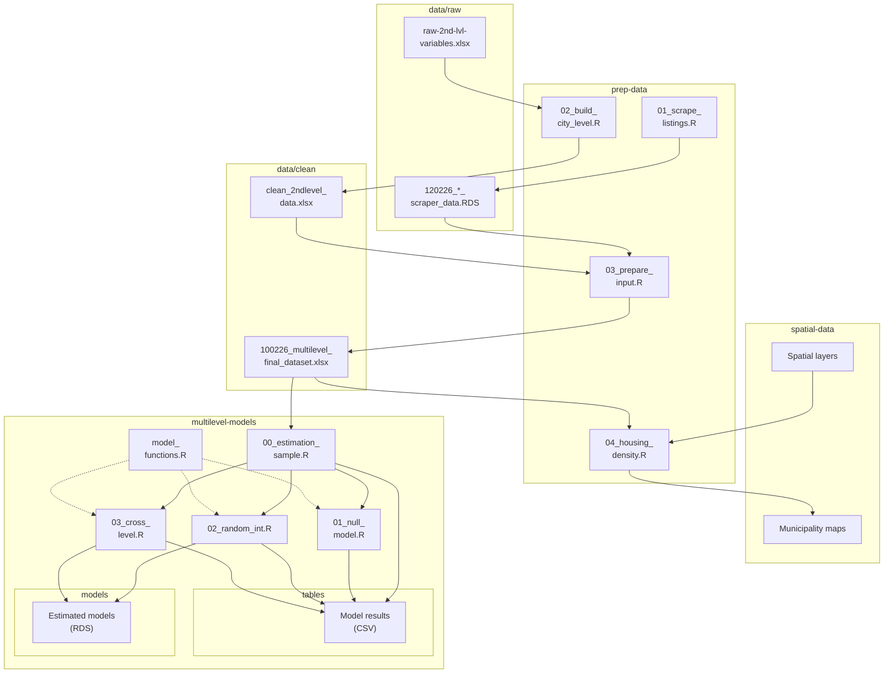

# str-density-colombia
This repository contains the replication data and R code for the paper "From Pressure to Saturation: A Multilevel Analysis of Short-Term Rental Density and Long-Term Rents in Colombia", which studies short-term rental (STR) density and long-term rents in 18 Colombian cities in 2025. Using dwelling-level and city-level characteristics, the study draws on 6.803 web-scraped rental listings nested within 18 cities to examine the association between STR activity and long-term rental prices.

The repository is organized as follows. Each box is a folder, and the arrows show how the scripts turn the raw data into the results of the paper.

It should be noted that all paths in the scripts are relative to the root folder of the repository. Thus, the scripts must be run from that folder.

## Folder: data

The repository includes both raw and clean data. The raw data (`data/raw`) are composed of two types of files:

- Files with the structure `120226_<city>_scraper_data.RDS`, which correspond to the listings and their dwelling attributes obtained from Fincaraíz (www.fincaraiz.com.co) through a web scraping procedure (see `prep-data/01_scrape_listings.R`).
- The file `raw-2nd-lvl-variables.xlsx`, which contains the raw data of the second-level variables drawn from secondary sources: sociodemographic data from the 2005 and 2018 censuses, economic data from the Departmental National Accounts, data from the National Quality of Life Survey (ECV) and the Great Integrated Household Survey (GEIH) on housing tenure and the labour market, respectively, tourism statistics from MinCIT, arrivals of non-resident foreign visitors from Migración Colombia, and, finally, public short-term rental market summaries by city published by AirDNA. Each source is stored in its own sheet, and the `sources` sheet describes all of them (dataset, producer, reference period, geographic level, variables, units and link).

After implementing the cleaning procedure described in `prep-data/02_build_city_level.R`, a clean dataset of the second-level variables is obtained, which corresponds to the file `data/clean/clean_2ndlevel_data.xlsx`. It has one row per city and the following structure:

| Variable | Description | Source |
|---|---|---|
| `ciudad` | City name | — |
| `departamento` | Department name | — |
| `cod.mun` | Five-digit municipal code (DIVIPOLA) | DANE |
| `ciudad_slug` | City identifier used in the Fincaraíz URLs | — |
| `pm_18` | Incidence of multidimensional poverty (%), 2018 | DANE, CNPV 2018 |
| `urban.05` | Population in the municipal head town (*cabecera*), 2005 | DANE, 2005 General Census |
| `rural.05` | Population outside the municipal head town, 2005 | DANE, 2005 General Census |
| `total.05` | Total population, 2005 | DANE, 2005 General Census |
| `urb.total.05` | Urban share of the population, 2005 (`urban.05` / `total.05`) | Computed |
| `total.18` | Total population adjusted for census coverage, 2018 | DANE, CNPV 2018 |
| `prop.young` | Share of the enumerated population aged 20 to 39, 2018 | DANE, CNPV 2018 |
| `casa_aptos` | Number of houses and apartments, 2018 | DANE, CNPV 2018 |
| `pib` | GDP of the department, 2024 (preliminary), billions of COP, chain-linked volume with reference year 2015 | DANE, Departmental National Accounts |
| `propia.prop` | Share of households in owned dwellings, fully paid or being paid (%), department total, 2024 | DANE, ECV 2024 |
| `ano` | Year of the labour market indicators | DANE, GEIH |
| `periodo` | Rolling quarter of the labour market indicators (October–December) | DANE, GEIH |
| `tasa_global_de_participacion_tgp` | Labour force participation rate (%), October–December 2025 | DANE, GEIH |
| `tasa_de_desocupacion_td` | Unemployment rate (%), October–December 2025 | DANE, GEIH |
| `viajeros` | Non-resident foreign visitors by destination municipality, November 2025 | Migración Colombia and MinCIT |
| `rnt2019` to `rnt2025` | Registered tourism service providers (distinct tax identification numbers), by year | MinCIT, National Tourism Registry |
| `visit2015` to `visit2025` | Non-resident foreign visitors by destination city, by year | Migración Colombia and MinCIT |
| `listings` | Active STR listings on Airbnb and Vrbo | AirDNA |
| `annual_revenue` | Average annual revenue per active listing (USD) | AirDNA |
| `occupancy` | Occupancy rate (%) | AirDNA |
| `adr` | Average daily rate (USD per booked night) | AirDNA |
| `rev_par` | Revenue per available rental night (USD) | AirDNA |

It also should be noted that, for the cities that the GEIH reports as metropolitan areas (v.g. Barranquilla, Bucaramanga, Cali, etc.), the labor market indicators refer precisely to the metropolitan area. The dataset keeps every second-level variable collected for the study, including those variables that do not enter the final specification. 

Then, `prep-data/03_prepare_input.R` merges the listings with the second-level variables into the file `data/clean/100226_multilevel_final_dataset.xlsx`, with one row per listing. Besides the second-level variables above, this file contains the following dwelling-level variables:

| Variable | Description |
|---|---|
| `id` | Listing identifier (municipal code and listing number) |
| `id_propiedad` | Listing number within the city |
| `slug_ciudad`, `slug_depto` | City and department identifiers used in the Fincaraíz URLs |
| `ubicacion` | Location of the dwelling as stated in the listing |
| `tipo_de_inmueble` | Property type: apartment (*Apartamento*) or house (*Casa*) |
| `precio` | Monthly rent (COP) |
| `banos` | Number of bathrooms |
| `habs` | Number of bedrooms |
| `area` | Floor area (m²) |
| `ses` | Socioeconomic stratum: low (strata 1–2), medium (3–4) or high (5–6) |
| `antiguedad` | Property age, in five categories |
| `amoblado` | Furnished dwelling (1) according to the listing description |

Finally, the same script records the number of listings retained at each step, by city, in `data/clean/sample_flow.csv`.

## Folder: spatial-data

This folder contains all the spatial data used in the paper. There are two main folders:

- `dane_grilla`, which includes `N6_1K`, the 1 km² statistical grid published by DANE with the results of the 2018 census for each cell. The number of housing units per cell is used to map housing density.
- `ShapeFiles`, which includes `DANE_geodata`, with the municipal boundaries of the National Geostatistical Framework (Marco Geoestadístico Nacional) of DANE (`MGN_ANM_MPIOS.shp`), and `World`, with the country boundaries used to draw the countries that border Colombia (`world.shp`).

The municipality maps produced by the script `prep-data/04_housing_density.R` are also saved in this folder, in one subfolder per municipality.

## Folder: prep-data

This folder includes the following four scripts:

- `01_scrape_listings.R`, whose purpose is to collect the rental listings of houses and apartments published on Fincaraíz for each city, together with their dwelling attributes. Each run returns the listings available on the platform at that moment, so a new run will not reproduce the data used in the study. The exact files used in the study are those in `data/raw`.
- `02_build_city_level.R`, which cleans the raw data in `raw-2nd-lvl-variables.xlsx` and builds the dataset of the second-level variables.
- `03_prepare_input.R`, which cleans the dwelling-level variables and merges the first-level and second-level variables into a single dataset.
- `04_housing_density.R`, which maps housing density within each municipality in the sample, with insets that locate the municipality in Colombia (Figure 1 in the manuscript).

## Folder: multilevel-models

In this folder, we provide the scripts that build the estimation sample and estimate the models reported in the manuscript:

- `05_estimation_sample.R`, which builds the variables of the models (logarithms and listing density) and centers them at their grand mean. It records the sample at each step in `output/tables/sample_flow_estimation.csv`.
- `06_null_model.R`, which estimates the null model and the intraclass correlation (ICC).
- `07_random_intercept_slope.R`, which estimates the random-intercept model (Model 2.1) and the model with a random slope for log floor area (Model 2.2).
- `08_cross_level.R`, which estimates the models with cross-level interactions (Models 3.1 to 3.4).
- `model_functions.R`, which defines the functions that tabulate the models and compute the intraclass correlation.

These scripts save their results in `models` and `tables`.

## Software

All the scripts were written in R. The packages used by each script are listed in its header:

- Data collection: `rvest`, `chromote`
- Data preparation: `readxl`, `writexl`, `janitor`, `dplyr`, `tidyr`, `purrr`, `stringr`, `stringi`
- Spatial data: `sf`, `ggplot2`, `ggspatial`, `cowplot`
- Estimation: `nlme`, `msm`

## License

The code in this repository is released under the MIT license (see `LICENSE`).

The data are subject to the terms of their original sources. Listing data from Fincaraíz and STR market data from AirDNA remain subject to the terms of use of those platforms and are shared only to allow verification of the results.

